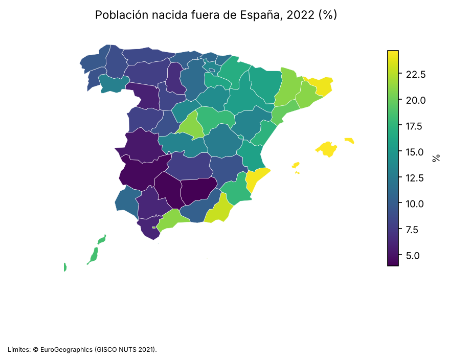
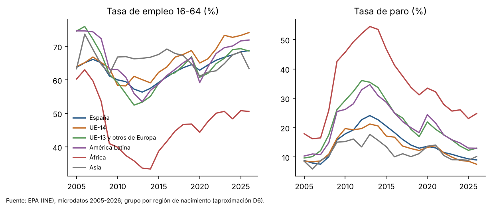
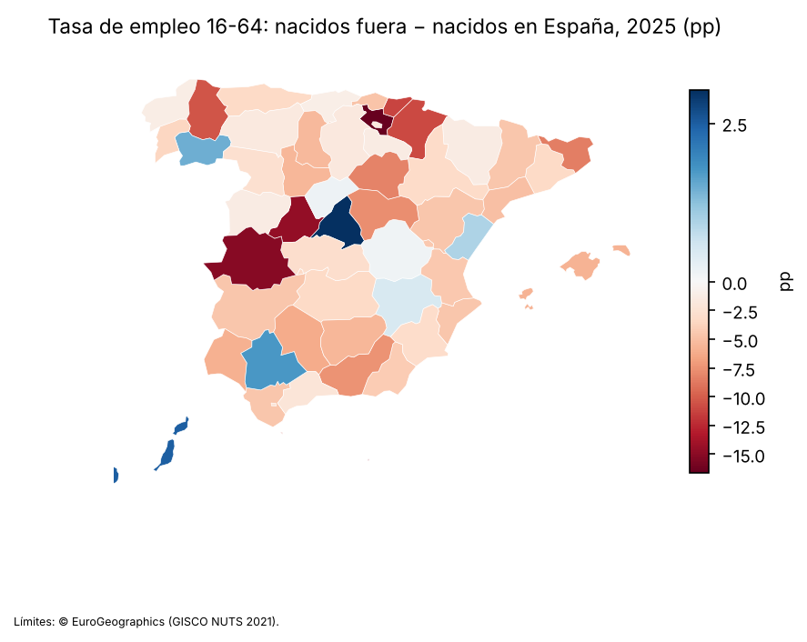
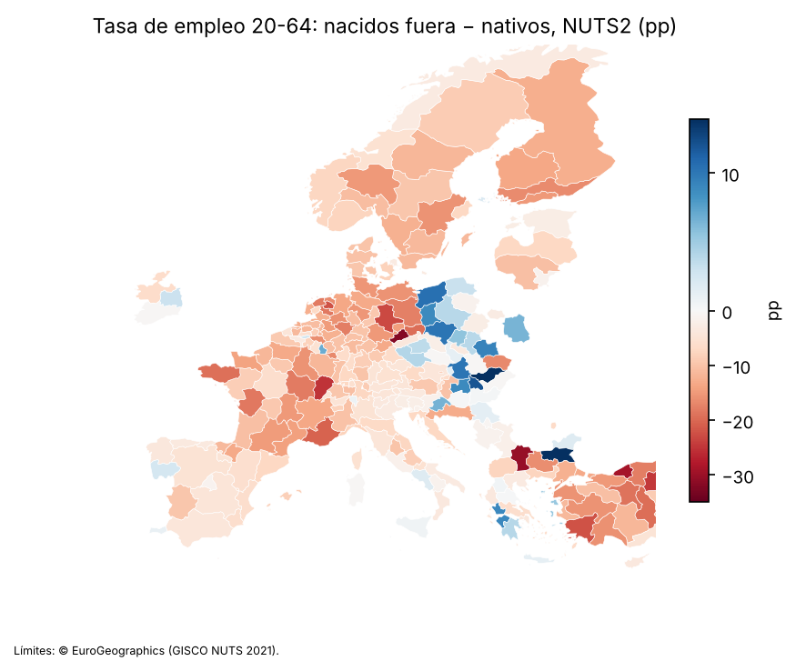
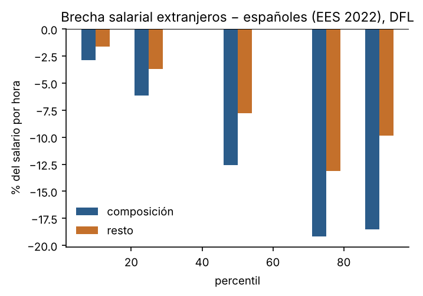
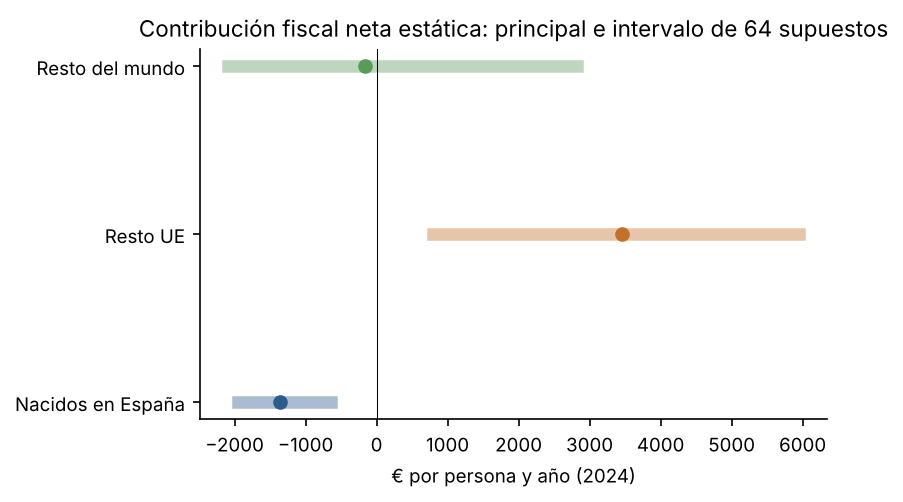
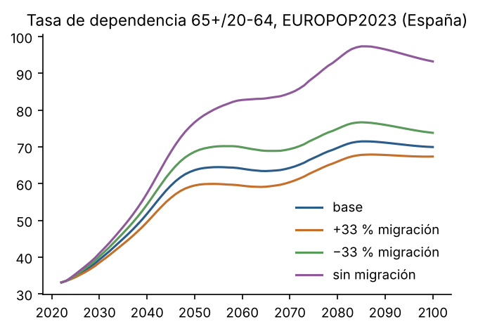

# Contribución e impacto económico de la población según su origen

*España por provincia y Europa por país y región, solo con información pública*

Documento de trabajo M1 · octubre de 2026 · Formato de la serie Documentos de Trabajo del Banco de España; no es una publicación del Banco de España ni ha pasado por su revisión.

## Resumen ejecutivo

**Pregunta.** El estudio separa dos preguntas que no se mezclan. La primera es la **contribución**, una pregunta de contabilidad: cuánto aporta y recibe cada grupo de origen en empleo, salarios, vivienda y cuentas públicas. La segunda es el **impacto**, una pregunta de identificación: qué efecto tiene la inmigración sobre la población local. Solo se usan datos públicos descargables sin solicitud.

**Población.** La población nacida fuera de España era el 15,9 % en el padrón de 2022 y el 19,3 % en la Estadística Continua de Población de 2025. En 1998 era el 2,9 %. En la UE-27 la cifra es del 14,4 % (Eurostat, que para España se basa en la misma estadística del INE). Es una población más joven: el 9,2 % tiene 65 o más años, frente al 23,5 % de los nacidos en España.

**Empleo.** En 2025 la tasa de empleo de 16 a 64 años es del 67,3 % entre los nacidos fuera y del 68,4 % entre los nacidos en España; a 25-54 años, del 73,2 % frente al 82,3 %, y para 16-64 años a igual edad y sexo la brecha es de -5,3 pp. La brecha bruta de 16-64 años es pequeña porque el 74,0 % de los nacidos fuera de esas edades tiene entre 25 y 54 años, las de más empleo, frente al 59,4 % de los nacidos en España, entre quienes pesan más los de 16-24 años (16,5 %, muchos estudiando) y los de 55-64 (24,1 %); en cada tramo de 25 a 64 años la tasa de los nacidos fuera es menor, y al compararlos con la misma estructura por edad y sexo la brecha se amplía (también pesa que entre ellos hay más mujeres: 52,7 % frente a 48,9 %). La variación interna es amplia: África 50,8 %, UE-14 73,3 %. El paro es mayor entre los nacidos fuera: 14,0 % frente a 9,4 %. Al aumento de la ocupación entre 2014 y 2025, de 4,9 millones, los nacidos fuera aportan el 55,6 %. Es contabilidad: no dice qué habría ocurrido sin inmigración.

**Salarios.** Los extranjeros cobran por hora un 18,1 % menos que los españoles (Encuesta de Estructura Salarial, EES, 2022). A igual edad, sexo, estudios y región la diferencia baja al 6,2 % menos (exploratorio, C4). En la descomposición de Oaxaca-Blinder, alrededor del 68,0 % de la brecha media corresponde a diferencias de composición observables.

**Vivienda.** Vive en vivienda en propiedad el 81,9 % de los nacidos en España, frente al 32,9 % de los nacidos fuera de la UE. La sobrecarga del gasto en vivienda afecta al 26,1 % de los segundos y al 4,9 % de los primeros.

**Cuentas públicas.** Contribución neta estática en 2024, en euros por persona: escenario principal de referencia e intervalo de las 64 combinaciones de supuestos (capa C2):
- nacidos en España: -1.404 [-1.990, -673];
- nacidos en el resto de la UE: 3.398 [726, 5.915];
- nacidos fuera de la UE: -191 [-2.118, 2.792].

Las cifras incluyen el déficit de las administraciones, que se reparte entre todos; con presupuesto equilibrado (criterio de la OCDE) las cifras suben para todos (sección 4). Para el conjunto de nacidos fuera, el signo depende de dos supuestos: con bienes públicos a coste medio y los hijos nacidos en España asignados a sus padres es negativo en todas las combinaciones de los demás supuestos ([-1.546, -700] €), y en las otras tres celdas, positivo. Estas comparaciones son brutas. La contribución de los nacidos fuera de la UE a igual edad y sexo, negativa en las 64 combinaciones ([-3.223, -12] €), está **al límite y depende de la convención**: con una infradeclaración diferencial de sus rentas del 10 % su intervalo ya contiene el cero (sección 4). A igual edad y sexo, la diferencia con los nativos es 240 € para el resto de la UE (positiva en las 64 combinaciones, aunque su intervalo de muestreo contiene el cero) y -1.708 € para el resto del mundo (su intervalo de muestreo no contiene el cero, pero el de supuestos sí: es positiva en las 32 combinaciones con bienes públicos a coste marginal cero). En el último grupo el signo depende del reparto de los bienes públicos y de la asignación de los hijos nacidos en España: el principal es solo una referencia y lo que se afirma es el intervalo (decisión del autor, D11; tablas de signo en output/f4/signo_por_supuestos.csv y output/f4/ciclo_vital_signos.csv). En el ciclo vital (valor actual de por vida) se dan cotas con escenarios de convergencia salarial con los nativos de la misma edad. En el rango anclado en la única estimación española leída (Izquierdo, Lacuesta y Vegas 2009: sin convergencia adicional a la del perfil transversal o cerrando la mitad de la brecha), quien llega del resto de la UE a los 50 años aporta más que un nativo de esa edad ([22, 209] miles de euros sin convergencia adicional), y quien llega de fuera de la UE a los 20 años aporta menos que un nativo de 20 solo sin convergencia ([-176, -37]). **En la prueba de estrés con divergencia ninguna diferencia con los nativos conserva el signo** (resto de la UE a los 50: [-3, 199]). El valor de las llegadas entre 20 y 50 años depende de supuestos en el escenario sin convergencia, y el de las llegadas a los 0 años es negativo salvo con convergencia completa, como el de un recién nacido en España. Todos los valores incluyen el déficit de 2024 y excluyen a los descendientes. Las sumas de las contribuciones cuadran con el saldo de las AAPP de 2024 y con cada partida de la contabilidad nacional (pruebas automáticas añadidas a posteriori, que detectaron y corrigieron dos errores; docs/cuadre.md).

**Pensiones.** La comparación de escenarios de EUROPOP2023 con una regla demográfica mecánica se ha movido al anexo J (a posteriori): es contabilidad demográfica con supuestos, y como efecto de la inmigración sobre el gasto en pensiones la pregunta es NO ESTIMABLE con datos públicos.

**Impacto sobre la población local.** La estimación causal se hizo con el diseño fijado en el plan de análisis interno (shift-share provincial con cuotas de 1998). Tras corregir un error de código en el control de cuotas incompletas detectado en la revisión (que cambió los signos de las confirmatorias; las tres lecturas del control se publican), el F efectivo de Montiel Olea y Pflueger de la primera etapa es 17,9, por debajo de su valor crítico para un sesgo del 10 % (23,1): no es una primera etapa fuerte (anexo A explica el otro diagnóstico de primera etapa que exigía el plan). **Los conjuntos de confianza AKM0, que tienen en cuenta la correlación entre provincias con orígenes parecidos, no están acotados: con esa inferencia no se puede descartar ningún efecto, de ningún tamaño ni signo.** Con la inferencia agrupada por provincia (intervalos de Anderson-Rubin, a posteriori), que tiende a rechazar de más en estos diseños, en la tasa de empleo de los nativos quedarían fuera los valores fuera de [-0,92, 0,98] puntos por punto, y no se pueden descartar los de dentro. **Con información pública, el diseño no tiene potencia para detectar efectos del tamaño que encuentra la literatura**: el efecto mínimo detectable (80 % de potencia, 5 %) en la tasa de empleo de los nativos es de 1,15 puntos por punto con el error al nivel del shock y de 1,21 con el implícito de AKM0, frente a efectos publicados de una décima o dos (la estimación española más cercana en escala que se ha podido leer, −0,18 puntos por punto de cuota en el empleo y no significativa, procede de una versión de trabajo sin DOI; anexo H). Por las reglas fijadas antes de estimar, **ningún efecto queda IDENTIFICADO ni SUGESTIVO**: todas las preguntas causales son ASOCIACIÓN o NO ESTIMABLE. Con información pública, el diseño no tiene potencia para detectar efectos del tamaño que encuentra la literatura en el empleo, los salarios o los servicios de la población local (efectos mínimos detectables de la sección 5). El indicio más consistente es desfavorable y exploratorio: la tasa de empleo de los nacidos en España con educación baja tiene una estimación de -0,61 puntos por punto, con un conjunto de confianza sin cota inferior, que no supera la corrección por multiplicidad ni el wild bootstrap; estandarizada por edad baja a -0,30 y pierde las señales que la apoyaban, y depende de una sola comunidad. Hay también indicios favorables más débiles, apoyados solo en el placebo de permutación, en el paro y en el empleo de los nativos con educación alta; la variante por nacionalidad y el multiverso no los acompañan (sección 5).

**Afirmaciones del debate.** Se evalúan doce afirmaciones: de las seis desfavorables a la inmigración, cinco con veredicto «no se puede saber» y una con veredicto «engañosa»; de las seis favorables a la inmigración, cuatro con veredicto «no se puede saber» y una con veredicto «engañosa» y una con veredicto «se sostiene con matices» (sección 7).

## Resumen no técnico

Casi una de cada cinco personas que viven en España nació fuera. Entre los 16 y los 64 años su tasa de empleo se parece a la de los nacidos en España, porque hay entre ellos más personas en las edades en que más se trabaja; pero en las edades centrales (25-54 años) y a igual edad y sexo trabajan menos, con más paro y empleos más temporales, y con grandes diferencias entre grupos. Cobran menos por hora; unos dos tercios de esa diferencia se corresponden con diferencias de edad, sexo, estudios y región, y el resto no se explica con esas variables. Viven mucho más de alquiler y dedican más parte de su renta a la vivienda.

En las cuentas públicas de un año (2024), los nacidos en otros países de la UE aportan más de lo que reciben en todas las combinaciones de supuestos estudiadas. Para los nacidos fuera de la UE, el resultado depende de cómo se repartan gastos como la defensa o los intereses de la deuda, y de si la educación de sus hijos nacidos en España se les imputa a ellos. Buena parte de esa ventaja corresponde a una estructura por edad más joven: comparados con nativos de la misma edad y sexo, la ventaja de los nacidos en otros países de la UE se reduce mucho, y para los nacidos fuera de la UE el resultado depende de supuestos. Cuando se mira toda la vida (impuestos de hoy y pensiones de mañana), el saldo de quien llega depende de supuestos; frente a un nacido en España de la misma edad, el resultado depende de cómo evolucione su salario respecto al de los nativos: quien llega de otro país de la UE a los 50 años aporta más si su salario converge o se mantiene, pero no si se aleja; quien llega de fuera de la UE a los 20 aporta menos si su salario no converge o se aleja.

Que la inmigración cambie el empleo o los salarios de los nacidos en España es otra pregunta. Con los datos públicos y el diseño fijado de antemano, la respuesta es que no se puede saber: las estimaciones son demasiado imprecisas para afirmar o descartar un efecto en cualquier sentido, incluso grande. Hay un indicio, no concluyente, de menor tasa de empleo de los nativos con estudios bajos en las provincias con más llegadas, y otros más débiles en sentido favorable (menos paro y más empleo de los nativos con estudios altos).

## 1. Introducción

Este documento mide la contribución de cada grupo de origen al empleo, a los salarios, a la vivienda y a las cuentas públicas en España (nacional, comunidad y provincia) y en Europa (país y NUTS2). Además prepara, con un plan de análisis interno fijado antes de estimar, la estimación del impacto de la inmigración sobre la población local (pregunta B).

**Alcance del plan de análisis interno.** El plan fijado en el commit c247555 cubre solo la fase 5 (impacto causal). Los hechos (C1), la contabilidad fiscal (C2) y el ciclo vital no estuvieron pre-especificados: sus supuestos se fijaron y revisaron durante el estudio, y por eso se publican como intervalos sobre rejillas de supuestos y con todas las sensibilidades (aclaración de la congelación, a posteriori).

Las dos preguntas se responden por separado. La contribución (A) es contabilidad. El impacto (B) exige identificación y solo se describe con lenguaje causal si queda IDENTIFICADO según reglas fijadas antes de estimar. Cada cifra lleva una capa:
- **C1, hechos:** dato oficial o dos fuentes independientes;
- **C2, cotas con supuestos explícitos:** contabilidad fiscal, proyecciones y demanda de hogares;
- **C3, efectos identificados:** ninguno en esta versión (sección 5);
- **C4, exploratorio:** brechas ajustadas por regresión, descomposiciones y pseudopaneles. Describen diferencias condicionales, no efectos.

Reglas comunes a todo el documento:
- Las comparaciones se dan en tres niveles: bruto; ajustado por edad y sexo; ajustado además por educación, años de residencia (cuando la fuente los tiene) y región. En la EPA el nivel completo se evalúa en el tramo de 10 a 19 años de residencia; con otro tramo de referencia las cifras cambian.
- Las diferencias brutas se descomponen en composición y resto.
- Se describen agregados y su variación interna; nunca se atribuyen rasgos a un grupo.
- Las afirmaciones favorables y desfavorables se evalúan con el mismo estándar.

## 2. Datos públicos y definiciones

**Origen.** El criterio principal es el país de nacimiento; la nacionalidad es la sensibilidad. Hay ocho grupos: nacidos en España; UE-14; UE-13 y otros de Europa; América Latina; Magreb; resto de África; Asia; resto.

**Qué permite cada fuente:**
- Padrón (1998-2022): ofrece los ocho grupos completos, también por provincia (output/f3/poblacion_provincias.csv).
- EPA: los aproxima por región de nacimiento, sin separar Magreb y resto de África (decisión D6).
- Encuesta de Condiciones de Vida (ECV) y Eurostat: solo distinguen España, resto de la UE y resto del mundo. La EPF solo añade la distinción entre resto de Europa y resto del mundo, que no basta para separar los grupos de fuera de Europa. Por eso la contabilidad fiscal no puede desagregar el «resto del mundo» con datos públicos: queda fuera de alcance (lo que haría falta: microdatos de la EU-SILC o registros fiscales con país de nacimiento, que no son públicos).
- EES: solo nacionalidad.

Los nacionalizados son el 33,4 % de los nacidos fuera. La segunda generación solo se identifica si convive con sus padres (EPA, ECV).

El inventario de fuentes, con URL, licencia, fecha y sha256, está en el anexo D y en `data/fuentes.csv`. Lo que no es público, y qué pregunta afecta, está en la sección 8.

**Protección de datos.** Solo se publican agregados y se suprimen las celdas con menos de 50 observaciones muestrales. Las encuestas públicas no traen estratos ni conglomerados, salvo la EES (establecimiento), y los errores se agrupan en consecuencia (D7).

## 3. Hechos: población, empleo, salarios, vivienda y prestaciones

### 3.1 Población

La población nacida fuera pasó del 2,9 % en 1998 al 15,9 % en 2022. Por grupos, en 2022: América Latina 7,0 %, UE-13 y otros de Europa 2,4 %, UE-14 2,3 %, Magreb 2,3 %, Asia 1,1 % y resto de África 0,6 %.

Por provincias va del 3,9 % al 24,7 % (mapa 1).

Entre 2021 y 2024 el saldo migratorio exterior de los nacidos fuera fue de 2,3 millones, y el de los nacidos en España de -0,1 millones.

El 35,2 % de los nacidos fuera de 16 o más años lleva 20 años o más en España, y el 23,7 % menos de 5.

En Europa, España ocupa el puesto 12 por cuota de nacidos fuera (19,3 % según Eurostat, que procede de la misma estadística del INE y no es una fuente independiente).

### 3.2 Empleo

Tasas de empleo de 16 a 64 años en 2025 (gráfico 1):
- nacidos en España: 68,4 %;
- UE-14: 73,3 %;
- UE-13 y otros de Europa: 69,4 %;
- América Latina: 71,7 %;
- África: 50,8 %;
- Asia: 68,4 %.

**Tres niveles** (los ajustados son C4). La brecha de África con los nacidos en España es de -17,6 pp en bruto, -22,2 pp a igual edad y sexo, y -13,5 pp al añadir educación, residencia (10 a 19 años) y región. La de América Latina es de 3,3 pp en bruto, -0,4 pp a igual edad y sexo y 4,9 pp en el nivel completo; a igual edad y sexo no es distinguible de cero (IC 95 % [-2,2, 1,3]).

**Por qué la brecha crece al ajustar por edad y sexo.** En 2025 el 74,0 % de los nacidos fuera de 16-64 años tiene entre 25 y 54 años, frente al 59,4 % de los nacidos en España; entre estos pesan más los jóvenes de 16-24 años (16,5 % frente a 10,9 %), con poco empleo porque muchos estudian, y los de 55-64 (24,1 % frente a 15,2 %). Esa composición acerca las tasas brutas (-1,2 pp), aunque en cada tramo de 25 a 64 años la de los nacidos fuera es menor (output/f3/empleo_composicion_2025.csv); con la estructura por edad y sexo de los nativos la brecha es -5,3 pp. También cuenta el sexo: las mujeres son el 52,7 % de los nacidos fuera de 16-64 años y el 48,9 % de los nativos.

**Nacimiento y nacionalidad** (a posteriori; ASOCIACIÓN). La tasa de empleo de 16-64 años de los nacidos fuera con nacionalidad española es del 73,2 % y la de los que no la tienen, del 64,5 %. Es una asociación con selección: la nacionalidad exige años de residencia que dependen del origen (dos para los iberoamericanos, diez con carácter general) e incluye a españoles nacidos fuera, y la estructura por edad es distinta (70,3 % y 75,6 % de 25-54 años). Dentro de cada tramo de años de residencia la diferencia se reduce pero no desaparece: con 0-4 años, 67,9 % frente a 56,5 %; con 5-9, 74,0 % frente a 67,3 %; con 10-19, 70,1 % frente a 66,7 %; con 20 o más, 75,2 % frente a 71,1 %. No se debe leer como un efecto de la nacionalidad.

**Calidad del empleo** (2025): contrato temporal, 17,9 % de los asalariados nacidos fuera frente al 14,5 %; ocupaciones elementales, 23,8 % frente al 8,4 %; ocupaciones de alta cualificación, 21,5 % frente al 41,1 %; titulados superiores en ocupaciones que no lo requieren, 44,6 % frente al 32,2 %.

**Por provincias**, la brecha de empleo entre nacidos fuera y nacidos en España va de -16,6 a 3,0 pp. En 9 provincias la tasa estimada de los nacidos fuera es mayor (estimaciones provinciales sin intervalo; mapa 2). Por provincia y grupo de nacimiento (a posteriori; EPA 2023-2025, celdas con menos de 50 observaciones suprimidas; output/f3/empleo_provincias_grupos.csv) hay tasa publicable en 50 provincias para América Latina, 50 para África, 50 para UE-13 y otros de Europa, 44 para UE-14 y 27 para Asia. La EPA pública no separa el Magreb del resto de África: en empleo hay siete grupos, no ocho.

**Crecimiento del empleo.** En 2014-2025 los nacidos fuera aportan el 55,6 % del aumento de la ocupación y el 71,8 % del de las horas.

**Europa.** La brecha de empleo de 20 a 64 años entre nacidos fuera y nativos es de -3,7 pp en España y de -6,4 pp en la UE-27 (mapa 3).

**Cohortes y generaciones** (C4). En el pseudopanel de cohortes de llegada (EPA 2005-2025, 25-54 años), la tasa de empleo relativa a los nativos de la cohorte llegada en 2015 o después es -8,1 pp distinta de la de la cohorte de 1995-2001 a igual tramo de residencia (IC 95 % [-12,4, -3,9]). Supuestos: efectos de periodo comunes a todas las cohortes y cohorte de referencia 1995-2001; la composición de cada cohorte cambia con las salidas. Los nacidos en España que conviven con un progenitor nacido fuera tienen una tasa de empleo -3,9 pp distinta (16-24 años) y -7,4 pp distinta (25-34) de la de quienes conviven con progenitores nacidos en España; solo se observa a quien convive con sus padres (output/f3/empleo_generaciones.csv).

### 3.3 Salarios

**Brecha de salario por hora** entre extranjeros y españoles (EES 2022, errores agrupados por establecimiento):
- bruta: -18,1 %;
- a igual edad y sexo: -15,5 %;
- además a igual estudios y región: -6,2 %;
- además a igual ocupación, sector, contrato y jornada: -3,0 % (informativo).

**Por percentiles**, la brecha es de -4,5 % en el 10, -19,4 % en la mediana y -26,5 % en el 90. La reponderación DFL atribuye a la composición el 64,0 %, el 62,0 % y el 66,0 % de la brecha en esos percentiles (gráfico 2; C4). Las cuotas de composición no llevan intervalo de confianza, y la de Oaxaca-Blinder usa como referencia la regresión agrupada; con otra referencia cambian.

**Segunda fuente.** Con la ECV, la mediana de los rendimientos del trabajo de los asalariados a jornada completa es un 29,5 % menor para los nacidos fuera de la UE.

**Convergencia salarial con los años de residencia: NO ESTIMABLE con datos públicos.** Ni la EES ni la ECV tienen años de residencia; haría falta la MCVL.

### 3.4 Vivienda

**Propiedad**, en la ECV 2021-2025:
- nacidos en España: 81,9 %;
- resto de la UE: 52,6 %;
- resto del mundo: 32,9 %.

Eurostat, como segunda fuente, da 84,1 % para los nativos y 38,7 % para los nacidos fuera. A igual edad, sexo, educación y región, la diferencia en propiedad de los nacidos fuera de la UE es de -45,3 pp (C4). Viven de alquiler a precio de mercado el 9,6 % de los nacidos en España, el 38,3 % de los nacidos en el resto de la UE y el 56,9 % de los nacidos fuera de la UE.

**Sobrecarga del gasto en vivienda** (ECV 2021-2025): 26,1 % de los nacidos fuera de la UE frente a 4,9 % de los nacidos en España.

**Hacinamiento** (Eurostat, 18 o más años, 2025): 19,6 % de los nacidos fuera frente a 5,6 % de los nativos.

**Demanda de hogares** (C2). A tasa de jefatura constante, el aumento de población de 2015-2022 implica 477 mil hogares de nacidos fuera y -225 mil de nacidos en España. No incluye la formación de hogares por envejecimiento.

### 3.5 Prestaciones

Personas que perciben cada prestación o viven en un hogar que la percibe (ECV 2021-2025, rentas de 2020-2024):

| Prestación | España | Resto UE | Resto del mundo |
|---|---|---|---|
| Desempleo (16-64) | 18,2 % | 22,9 % | 21,1 % |
| Jubilación (65+) | 72,5 % | 55,9 % | 44,1 % |
| Rentas mínimas e IMV | 5,5 % | 6,5 % | 11,9 % |
| Ayudas a la vivienda | 1,8 % | 2,2 % | 4,9 % |

A igual edad, sexo, educación y región (C4), la diferencia en rentas mínimas de los nacidos fuera de la UE es de 6,0 pp, y en jubilación de -29,0 pp. Rentas mínimas, IMV y ayudas a la vivienda son el 2,5 % de las prestaciones monetarias. Errores agrupados por hogar y año (la ECV pública no trae estratos ni conglomerados). Los registros administrativos (SEPE, IMV, pensionistas) solo distinguen nacionalidad; el contraste con ellos no se ha hecho y queda como mejora futura (docs/fuentes/admin.md). Las prestaciones del hogar se atribuyen a cada miembro, así que las tasas miden personas que viven en hogares perceptores, no hogares.

## 4. Contabilidad fiscal estática y de ciclo vital

**Método.** Se sigue la OCDE (2021; referencia NO VERIFICADA por discrepancia de autor en Crossref) adaptada a datos públicos. Los ingresos y los gastos de las administraciones de 2024 se reparten entre las personas de la ECV 2025:
- impuestos sobre la renta, cotizaciones y prestaciones, observados en la encuesta y calibrados a las cuentas;
- IVA e impuestos especiales con la Encuesta de Presupuestos Familiares (EPF);
- sanidad con el perfil de uso de la Encuesta Nacional de Salud (ENSE);
- educación según matrícula;
- bienes públicos puros (servicios generales e intereses, defensa) a coste medio o a coste marginal cero.

Los ingresos no tributarios se reparten por persona, de modo que la suma cuadra con el saldo de las administraciones. **Cuadre (a posteriori).** Unas pruebas automáticas comprueban que la suma ponderada de las contribuciones netas es el saldo de las AAPP de cada año (Eurostat, B9; 2024: −51.267 M€), que cada partida reproduce su total de la contabilidad nacional y que los perfiles por edad del ciclo vital, agregados con la pirámide de 2024, reproducen los totales de la contabilidad estática, con una tolerancia de 1 millón de euros. Al introducirlas fallaron dos: la sanidad omitía las prestaciones monetarias sanitarias (1.735 M€ en 2024) y el ciclo vital no reproducía lo que la contabilidad atribuye a los tramos de edad con pocas observaciones. Las dos se corrigieron; las cifras cambian en decenas de euros por persona (lista completa, antes y después, en docs/cuadre.md).

**Resultado estático (capa C2, gráfico 3).** Contribución neta por persona en 2024: escenario principal de referencia, intervalo de las 64 combinaciones de supuestos e intervalo de muestreo del principal (bootstrap por hogares, 200 réplicas):
- **nacidos en España:** -1.404 €; supuestos [-1.990, -673]; muestreo [-1.627, -1.151];
- **resto de la UE:** 3.398 €; supuestos [726, 5.915], positiva en las 64 combinaciones; muestreo [2.444, 4.307];
- **resto del mundo:** -191 € (solo referencia, D11); supuestos [-2.118, 2.792]; muestreo [-565, 259]. El signo depende de los bienes públicos y de los hijos nacidos en España (output/f4/signo_por_supuestos.csv).

**Déficit y comparación con los nativos.** Las cifras anteriores reparten el déficit de 2024 entre todos, por lo que los nacidos en España salen negativos en todos los supuestos. Dos lecturas complementarias:
- **Presupuesto equilibrado** (criterio de la OCDE: el saldo se reparte por igual por persona y la suma es cero): nacidos en España -351 € [-937, 144]; resto de la UE 4.450 € [1.779, 6.730]; resto del mundo 862 € [-1.065, 3.620].
- **Diferencia con los nacidos en España** en cada combinación de supuestos: resto de la UE 4.801 € [1.766, 7.603]; resto del mundo 1.213 € [-1.209, 4.557]. Para el resto del mundo el intervalo contiene el cero.
- **Conjunto de nacidos fuera** (la cantidad de las afirmaciones A5 y F3): 493 € [-1.546, 3.307]; frente a los nativos, 1.897 € [-638, 5.066]. El signo lo deciden solo los bienes públicos y la asignación de los hijos: coste medio e hijos a los padres, [-1.546, -700]; coste medio e hijos al hijo, [425, 1.115]; coste marginal e hijos a los padres, [155, 1.001]; coste marginal e hijos al hijo, [2.618, 3.307].

**A igual edad y sexo (C4).** Las cifras anteriores son brutas: buena parte de la ventaja frente a los nativos procede de la estructura por edad, porque las pensiones y la sanidad de los mayores pesan en los nativos. Con la estructura por edad (tramos de 5 años, 85 y más agrupado) y sexo de los nacidos en España y cobertura de todas las edades (donde una celda del grupo tiene menos de 10 observaciones se usa la media de su tramo de edad), la diferencia con los nativos es 240 € para el resto de la UE, positiva en las 64 combinaciones ([14, 3.010]), y -1.708 € para el resto del mundo, con un intervalo de supuestos que contiene el cero ([-1.976, 1.668], positiva en 32 de 64). En el principal, el IC 95 % aproximado por muestreo (error típico de 100 réplicas bootstrap por hogares, no centradas en la estimación) es [-654, 1.133] para el resto de la UE, que contiene el cero, y [-2.152, -1.264] para el resto del mundo. Es decir: a igual edad y sexo la ventaja del resto de la UE se reduce mucho y deja de ser distinguible de cero por muestreo; para el resto del mundo, el principal (-1.708 €, solo como referencia) tiene un intervalo de muestreo que no contiene el cero, pero el resultado depende de los bienes públicos: con coste marginal cero es positiva en todas las combinaciones de los demás supuestos. Para el resto de la UE coincide con Fiorio et al. (2023), que no hallan diferencia significativa a igual composición (condicionando también por la situación laboral); para el resto del mundo, solo en la variante sin bienes públicos, que es la comparable con su método. Una primera versión de este cálculo usaba solo celdas con al menos 50 observaciones, lo que excluía las edades en que los nacidos fuera salen mejor y daba diferencias negativas para los dos grupos; se corrigió en la revisión (docs/desviaciones.md, 22).

En prestaciones monetarias, los nacidos fuera de la UE reciben 1.927 € por persona y los nacidos en España 6.252 €, sobre todo por las pensiones. A igual edad y sexo siguen recibiendo menos: -3.621 € (resto del mundo) y -3.224 € (resto de la UE).

**Ciclo vital (C2).** Valor actual en 2024 de la contribución neta de por vida según la edad de llegada. Supuestos del escenario principal:
- supervivencia de la tabla de mortalidad de España;
- salida (retorno o reemigración) con un riesgo que decrece con la duración de la residencia, calibrado a la tasa observada de 6,3 % anual (emigraciones de nacidos fuera de 2021-2024 sobre el stock medio del mismo periodo). El riesgo es del 14,9 % anual en los primeros cinco años. La tasa incluye bajas por caducidad del padrón que no siempre son salidas reales, así que es una cota superior de las salidas;
- quien sale conserva la pensión contributiva devengada (exportable), que exige 15 años cotizados;
- sin convergencia adicional: el perfil transversal por edad ya mezcla duraciones de residencia, y añadir convergencia la contaría dos veces;
- descuento del 3 % y bienes públicos a coste medio.

Resultados en miles de euros (principal y, entre corchetes, el intervalo de las 24 combinaciones de salida, descuento y bienes públicos sin convergencia adicional; las combinaciones con convergencia se informan aparte porque la contarían dos veces):
- llegada a los 20 años: resto de la UE 8 [-29, 115]; resto del mundo -15 [-113, 44];
- llegada a los 30 años: resto de la UE 26 [-34, 112]; resto del mundo 5 [-99, 51];
- llegada a los 40 años: resto de la UE 27 [-51, 75]; resto del mundo 1 [-109, 36];
- llegada a los 0 años: resto de la UE -59 [-189, -34]; resto del mundo -71 [-271, -43] (sin descendientes);
- llegada a los 50 años: resto de la UE 2 [-110, 31]; resto del mundo -20 [-163, 5];
- comparador, nacido en España de 30 años (vida restante, sin salidas; intervalo: descuento y bienes públicos): 98 [29, 120]; recién nacido en España: -88 [-144, -83].

**Signo (D11).** Para los dos grupos, todos los intervalos de llegada entre 20 y 50 años contienen el cero (resto del mundo, llegada a los 20: [-113, 44]; a los 50: [-163, 5]), y por D11 no se les asigna signo. La diferencia con un nacido en España de la misma edad (al que, con coste marginal cero para los nacidos fuera, se le carga su parte de los bienes públicos, 498 € al año) tiene signo en dos casos: es negativa en las 24 combinaciones para quien llega de fuera de la UE a los 20 años (-111 [-176, -37]) y positiva en todas para quien llega del resto de la UE a los 50 (117 [22, 209]). En las demás contiene el cero (fuera de la UE, llegada a los 30: -93 [-150, 3]). Esos signos dependen del escenario de convergencia (tablas siguientes): con convergencia de 0,5 o 1, la diferencia a los 20 años del resto del mundo va de -103 a 119 (mediana -55), y la de quien llega de fuera de la UE a los 50 años, de 13 a 212. El comparador nativo no tiene salidas; como las salidas suben el valor actual, eso juega en contra del nativo en la comparación. Para la llegada a los 30, la parte hasta los 64 años («población joven hoy») es 28 y la de 65 y más años -22 (resto del mundo). Una primera versión de este cálculo omitía los ingresos no tributarios que se reparten por persona (1.836 € al año), lo que sumaba esa cantidad al déficit de todos; se corrigió en la revisión (docs/desviaciones.md, 20).

**Cotas con cuatro escenarios de convergencia salarial** (a posteriori; el rango anclado en la evidencia y la prueba de estrés se separan en el párrafo «Qué sobrevive»; output/f4/ciclo_vital_convergencia.csv). La convergencia cierra una fracción c de la brecha de impuestos, cotizaciones (y con ellas la pensión) y prestaciones no contributivas con los nativos de la misma edad, linealmente en 20 años: nula (c = 0, el principal), parcial (c = 0,5) o completa (c = 1). Como la convergencia solo puede mejorar el resultado de los nacidos fuera, se añade un escenario desfavorable simétrico del parcial, divergente (c = −0,5: la brecha se amplía la mitad en 20 años), que aproxima aplicar un perfil de llegados recientes que no se asimilan. El perfil transversal ya contiene parte de la convergencia, así que c = 1 es una cota optimista y c = −0,5 una cota pesimista. Cada celda es el intervalo, en miles de euros, de las 24 combinaciones de salida, descuento y bienes públicos.

Valor actual de por vida:

| Llegada | Grupo | Divergente (c = −0,5) | Sin convergencia | Convergencia parcial (c = 0,5) | Convergencia completa (c = 1) |
|---|---|---|---|---|---|
| 0 años | resto de la UE | [-233, -36] | [-189, -34] | [-145, -16] | [-102, 24] |
| 0 años | resto del mundo | [-358, -49] | [-271, -43] | [-185, -37] | [-98, 27] |
| 20 años | resto de la UE | [-77, 88] | [-29, 115] | [4, 142] | [12, 178] |
| 20 años | resto del mundo | [-197, 5] | [-113, 44] | [-30, 96] | [-1, 161] |
| 30 años | resto de la UE | [-78, 84] | [-34, 112] | [10, 139] | [32, 167] |
| 30 años | resto del mundo | [-169, 31] | [-99, 51] | [-31, 99] | [23, 147] |
| 40 años | resto de la UE | [-91, 61] | [-51, 75] | [-11, 101] | [28, 128] |
| 40 años | resto del mundo | [-186, 21] | [-109, 36] | [-48, 63] | [8, 102] |
| 50 años | resto de la UE | [-148, 23] | [-110, 31] | [-71, 40] | [-33, 51] |
| 50 años | resto del mundo | [-214, -6] | [-163, 5] | [-112, 17] | [-61, 29] |

Diferencia con un nacido en España de la misma edad:

| Llegada | Grupo | Divergente (c = −0,5) | Sin convergencia | Convergencia parcial (c = 0,5) | Convergencia completa (c = 1) |
|---|---|---|---|---|---|
| 20 años | resto de la UE | [-140, -1] | [-92, 36] | [-87, 84] | [-82, 132] |
| 20 años | resto del mundo | [-260, -50] | [-176, -37] | [-103, 36] | [-92, 119] |
| 30 años | resto de la UE | [-128, 25] | [-89, 33] | [-83, 73] | [-78, 116] |
| 30 años | resto del mundo | [-219, -12] | [-150, 3] | [-98, 32] | [-88, 101] |
| 40 años | resto de la UE | [-55, 113] | [-28, 122] | [-10, 132] | [-4, 171] |
| 40 años | resto del mundo | [-140, 71] | [-82, 89] | [-40, 104] | [-22, 151] |
| 50 años | resto de la UE | [-3, 199] | [22, 209] | [48, 220] | [74, 231] |
| 50 años | resto del mundo | [-57, 169] | [-22, 182] | [13, 197] | [48, 212] |

**Qué sobrevive, con un rango anclado en la evidencia y con una prueba de estrés** (congelación, a posteriori). (i) *Rango basado en evidencia, c ∈ [0; 0,5].* La única estimación española publicada de convergencia salarial con controles que se ha leído, Izquierdo, Lacuesta y Vegas (2009, Labour Economics, DOI 10.1016/j.labeco.2009.08.011; cifras de su versión de trabajo, Banco de España DT 0904), encuentra que los inmigrantes de fuera de la UE-15 cierran en torno a la mitad de la brecha salarial de entrada en 5-8 años y que la convergencia se detiene después (comparación con nativos de igual experiencia, educación y cohorte; muestra de varones de 25-54 años de la MCVL). Como el perfil transversal de M1 ya mezcla duraciones de residencia, y la mayoría del stock lleva más de 10 años, esa convergencia está en buena parte dentro del perfil: c = 0 es la cota inferior basada en la evidencia y c = 0,5 la superior (aplicar la mitad de la brecha transversal como si fuera la de entrada); c = 1 queda fuera de lo que encuentra la literatura leída y es solo una cota optimista. En ese rango sobreviven dos conclusiones de signo: quien llega del resto de la UE a los 50 años aporta más que un nativo de su edad ([22, 209] y [48, 220] miles de euros), y el valor de por vida de quien llega a los 0 años es negativo para los dos grupos, como el de un recién nacido en España (sin descendientes). La diferencia negativa de quien llega de fuera de la UE a los 20 años no sobrevive (con c = 0,5, [-103, 36]). (ii) *Prueba de estrés, c = −0,5* (simétrica del parcial; la evidencia no apoya una divergencia media, solo convergencia nula en algunos subgrupos). Añadida al rango anterior, solo sobrevive el valor negativo de las llegadas a los 0 años. La diferencia del resto de la UE a los 50 años pasa a contener el cero ([-3, 199]); a quien llega a los 50 se le aplica además un perfil de residentes antiguos (sesgo a favor), y su tramo de 70 y más años procede de celdas con pocas observaciones (con esos tramos rellenados con el perfil nativo sin escalar, la diferencia del principal es 123). Con divergencia son negativas la diferencia de quien llega de fuera de la UE a los 20 y a los 30 años y, por muy poco, la de quien llega del resto de la UE a los 20 ([-140, -1]). Las afirmaciones de signo del ciclo vital dependen del escenario de convergencia, que los datos públicos no permiten fijar (NO ESTIMABLE sin trayectorias individuales).

**Qué supuesto empuja en qué dirección** (output/f4/ciclo_vital_signos.csv):
- Las salidas cuentan mucho. Sin salidas (toda la vida en España), la llegada a los 30 da -42 (resto del mundo) y 22 (resto de la UE). La razón es que quien sale deja de generar gasto en sanidad y servicios en la vejez, aunque se lleve la pensión devengada. El principal usa la tasa observada, que es una cota superior de las salidas porque incluye bajas por caducidad; si las salidas reales fueran la mitad, la llegada a los 30 daría -7 (resto del mundo) y 29 (resto de la UE). Es decir, el principal está sesgado al alza en la dirección del sesgo de las caducidades.
- La convergencia, un descuento más alto y los bienes públicos a coste marginal cero mejoran el resultado.
- Los perfiles incluyen el déficit de 2024: todos los valores, también los de los nativos, salen más negativos que con presupuesto equilibrado.
- No se cuentan los descendientes ni su educación.

**Otras variantes del principal** (output/f4/ciclo_vital_sensibilidad.csv). Con presupuesto equilibrado, la llegada a los 30 da 16 (resto del mundo) y 37 (resto de la UE), y un nacido en España de 30 años 133. Rellenar los tramos de edad suprimidos con el perfil nativo sin escalar da 29 para el resto de la UE a los 30 años y 8 a los 50 (los tramos de 0 a 24 y de 70 y más años de este grupo tienen menos de 50 observaciones; en el principal entran en el ciclo vital a través de sus totales agrupados, que pesan sobre todo en la llegada a los 50). Quitar el mínimo de 15 años cotizados, una aproximación a la totalización europea de periodos, da -1 (resto del mundo) y 18 (resto de la UE); quitar el suelo de pensión no contributiva, 5 (resto del mundo). Con la mitad de salidas y sin el mínimo de 15 años a la vez, la llegada a los 30 da 23 (resto de la UE) y -12 (resto del mundo). Dos sesgos de signo opuesto: el gasto en especie por edad (sanidad, educación y protección social) se toma del perfil nativo, lo que en 2024 añade al gasto imputado a los nacidos fuera unas decenas de euros por persona y año frente a su propio perfil (docs/cuadre.md); y el perfil por edad es el de quienes residen hoy. Sin convergencia, a quien llega a los 20 se le aplica a los 30-44 años un perfil que mezcla recién llegados (en contra), y a quien llega a los 40 o 50 un perfil de residentes antiguos (a favor). El IBI se imputa solo a los propietarios, sin traslado a los inquilinos.

**Sensibilidad.** En la contabilidad estática lo que más mueve el resultado es la asignación de los hijos nacidos en España y el reparto de los bienes públicos. Imputar coste marginal cero a los nacidos fuera traslada su parte de los bienes públicos a los nacidos en España (-498 € por persona). Los impuestos indirectos, el uso sanitario observado frente a igual uso por edad, la calibración y el reparto del capital mueven menos (output/f4/sensibilidad_supuestos.csv).

**Sensibilidad por convención, igual para los tres grupos** (a posteriori; euros por persona en 2024; output/f4/sensibilidad_convenciones.csv). Cada fila cambia una sola convención respecto al principal. La última es una cota extrema: la ECV pública no dice qué Estado paga cada pensión, y la fila supone que todas las de los nacidos en el resto de la UE las paga otro Estado (también las españolas de quien cotizó aquí). El total de prestaciones D62 se mantiene, porque es el gasto que paga España, y se reparte entre los demás grupos en proporción a sus pensiones. Es una cota unilateral: el principal es el extremo opuesto (todas las pensiones declaradas en la ECV son españolas).

| Convención (una cada vez) | Nacidos en España | Resto de la UE | Resto del mundo | Nacidos fuera (conjunto) | Diferencia con los nativos: resto de la UE | resto del mundo | nacidos fuera |
|---|---|---|---|---|---|---|---|
| principal | -1.404 | 3.398 | -191 | 493 | 4.801 | 1.213 | 1.897 |
| presupuesto equilibrado (déficit repartido por igual) | -351 | 4.450 | 862 | 1.546 | 4.801 | 1.213 | 1.897 |
| bienes públicos puros a coste marginal cero para los nacidos fuera | -1.901 | 5.590 | 2.002 | 2.686 | 7.492 | 3.903 | 4.587 |
| sociedades y capital por persona | -1.467 | 2.977 | 251 | 770 | 4.444 | 1.717 | 2.237 |
| sanidad con el uso observado por origen | -1.388 | 3.227 | -235 | 425 | 4.615 | 1.153 | 1.813 |
| impuestos indirectos con tasa uniforme | -1.429 | 3.465 | -67 | 607 | 4.895 | 1.363 | 2.036 |
| educación de los hijos nacidos en España asignada a los padres | -925 | 1.016 | -2.081 | -1.491 | 1.941 | -1.157 | -566 |
| cota: pensiones de los nacidos en el resto de la UE pagadas por otro Estado | -1.447 | 4.433 | -196 | 686 | 5.880 | 1.251 | 2.134 |

La asignación de los hijos nacidos en España es la única convención que cambia el signo de la diferencia con los nativos del resto del mundo y del conjunto de nacidos fuera; ninguna lo cambia para el resto de la UE.

**Cobertura de las encuestas antes de escalar** (congelación, a posteriori; output/f4/cobertura_2024.csv). Las partidas que la ECV observa (impuestos sobre la renta y cotizaciones, prestaciones monetarias) se escalan con un factor único por partida, igual para todas las personas y todos los grupos de origen: el escalado no cambia el reparto entre grupos. Las demás (IVA, especiales, vivienda, sociedades y capital, gasto en especie) toman de la encuesta solo la distribución; el total es siempre el de las cuentas.

| Partida | Fuente | Total en la encuesta antes de escalar, en % del de las cuentas | Cómo se escala |
|---|---|---|---|
| IRPF y cotizaciones del trabajador | ECV | 88,1 | factor único, igual para todos |
| Cotizaciones empresariales | ECV | 106 | factor único, igual para todos |
| Desempleo | ECV | 94,3 | factor único, igual para todos |
| Vejez | ECV | 103 | factor único, igual para todos |
| Supervivencia | ECV | 84,5 | factor único, igual para todos |
| Enfermedad e incapacidad | ECV | 51,6 | factor único, igual para todos |
| Familia | ECV | 36,1 | factor único, igual para todos |
| Exclusión social | ECV | 72,3 | factor único, igual para todos |
| Vivienda | ECV | 603 | factor único, igual para todos |
| Becas y prestaciones de educación | ECV | 8.074 | factor único, igual para todos |
| IVA (EPF 2022) | EPF | 51,9 | solo distribución; total de las cuentas |
| IVA (EPF 2023) | EPF | 53,1 | solo distribución; total de las cuentas |

La cobertura es baja en familia, enfermedad e incapacidad y en el IVA de la EPF (que no incluye el IVA de las administraciones ni el de la vivienda nueva), y la ECV declara mucho más que las cuentas en vivienda y en becas: son prestaciones que la contabilidad nacional clasifica en otras funciones o como gasto en especie, y su escalado las reduce mucho (las dos son pequeñas). Un factor único supone que la infradeclaración es la misma en todos los grupos; la tabla siguiente relaja ese supuesto para los ingresos.

**Infradeclaración diferencial de rentas** (congelación, a posteriori; output/f4/infradeclaracion_resumen.csv). No se ha localizado una estimación publicada y verificada de la infradeclaración de rentas por origen en la ECV, así que se usa una rejilla explícita: las rentas que declaran los nacidos fuera se elevan por 1/(1 − d), con d = 0, 10 y 20 %, antes de calibrar o repartir los impuestos ligados a la renta; los totales siguen siendo los de las cuentas (los impuestos se reasignan de los nativos a los nacidos fuera) y las prestaciones no se tocan. Se recalculan las 64 combinaciones de supuestos.

| Cifra (€ por persona; principal [intervalo de las 64]) | d = 0 | d = 10 % | d = 20 % |
|---|---|---|---|
| Contribución neta, resto de la UE (C2) | 3.398 [726, 5.915] | 4.554 [1.529, 7.198] | 5.948 [2.497, 8.784] |
| Contribución neta, resto del mundo (C2) | -191 [-2.118, 2.792] | 594 [-1.480, 3.596] | 1.540 [-712, 4.593] |
| Contribución neta, nacidos fuera (C2) | 493 [-1.546, 3.307] | 1.349 [-852, 4.171] | 2.380 [-15, 5.243] |
| Diferencia con nativos, resto de la UE (C2) | 4.801 [1.766, 7.603] | 6.152 [2.748, 8.958] | 7.780 [3.931, 10.630] |
| Diferencia con nativos, resto del mundo (C2) | 1.213 [-1.209, 4.557] | 2.192 [-417, 5.440] | 3.372 [554, 6.503] |
| Diferencia con nativos, nacidos fuera (C2) | 1.897 [-638, 5.066] | 2.947 [222, 6.004] | 4.212 [1.269, 7.133] |
| Igual edad y sexo, resto de la UE (C4) | -1.164 [-1.322, 1.391] | -291 [-580, 2.349] | 762 [316, 3.533] |
| Igual edad y sexo, resto del mundo (C4) | -3.111 [-3.223, -12] | -2.452 [-2.564, 654] | -1.658 [-1.769, 1.481] |
| Igual edad y sexo, diferencia, resto de la UE (C4) | 240 [14, 3.010] | 1.307 [906, 4.059] | 2.594 [1.983, 5.349] |
| Igual edad y sexo, diferencia, resto del mundo (C4) | -1.708 [-1.976, 1.668] | -854 [-1.163, 2.428] | 174 [-161, 3.344] |
| Contribución neta, nacidos en España (C2) | -1.404 [-1.990, -673] | -1.598 [-2.163, -745] | -1.832 [-2.372, -831] |

Cambios de signo (D11) frente a d = 0: con d = 10 % pasa a ser positiva en las 64 combinaciones la diferencia del conjunto de nacidos fuera con los nativos (C2), y la contribución del resto del mundo a igual edad y sexo deja de ser negativa en todas (C4); con d = 20 % también pasan a ser positivas en las 64 la diferencia del resto del mundo con los nativos (C2) y la contribución del resto de la UE a igual edad y sexo (C4). Ninguna cifra cambia de signo en sentido desfavorable, porque la rejilla solo explora infradeclaración de los nacidos fuera; una infradeclaración mayor de los nativos movería las cifras en sentido contrario y no se ha explorado.

**Resto del mundo a igual edad y sexo: al límite y dependiente de la convención.** Su contribución neta a igual edad y sexo, [-3.223, -12] € en las 64 combinaciones, excluye el cero por muy poco. Cambiando una convención cada vez sigue siendo negativa; con infradeclaración diferencial, su intervalo de 64 contiene el cero desde d = 10 %, y con d = 20 % la convención de bienes públicos a coste marginal la vuelve positiva:

| Convención (una cada vez) | d = 0 | d = 10 % | d = 20 % |
|---|---|---|---|
| principal | -3.111 | -2.452 | -1.658 |
| bienes públicos a coste marginal cero | -919 | -260 | 535 |
| capital por persona | -2.612 | -2.033 | -1.335 |
| sanidad observada | -3.223 | -2.564 | -1.769 |
| indirectos uniformes | -3.014 | -2.347 | -1.544 |
| hijos a los padres | -2.740 | -2.073 | -1.269 |
| sin calibrar | -2.919 | -2.189 | -1.288 |

**Nacimiento y nacionalidad** (a posteriori; ASOCIACIÓN; output/f4/neta_nacimiento_x_nacionalidad_2024.csv). Entre los nacidos fuera de la UE, quienes tienen nacionalidad española aportan 1.303 € por persona y quienes no la tienen, -1.547 €; entre los nacidos en el resto de la UE, 3.733 € y 3.375 €. Es una asociación con selección: la nacionalidad exige años de residencia que dependen del origen (dos para los iberoamericanos, diez con carácter general), y el grupo incluye a españoles nacidos fuera (por ejemplo, hijos de españoles emigrados), así que la diferencia mezcla residencia, edad, empleo y origen y no es un efecto de la nacionalidad. La ECV pública no tiene años de residencia y no permite la comparación por tramos. Por nacionalidad sola (la sensibilidad del plan) el resto del mundo es más negativo que por nacimiento porque los nacionalizados, que aportan más, pasan al grupo de los españoles (output/f4/neta_por_nacionalidad_2024.csv).

**Europa.** No se replica: hacen falta los microdatos de investigación de la EU-SILC, que no son públicos. Se comparan los resultados publicados. Fiorio et al. (2023, *International Tax and Public Finance*) estiman para España, en 2014-2018, una contribución neta por persona de los inmigrantes mayor que la de los nativos, sin diferencia significativa a igual composición demográfica. La cantidad comparable de este estudio es la diferencia con los nativos, con dos diferencias de diseño: el periodo (2024 frente a 2014-2018) y los bienes públicos. En bruto, para el resto de la UE la diferencia es positiva en las 64 combinaciones, en la dirección de Fiorio et al.; para el resto del mundo el intervalo contiene el cero. A igual edad y sexo, que es el nivel en que Fiorio et al. no hallan diferencia, la de M1 es positiva para el resto de la UE en todos los supuestos pero no distinguible de cero por muestreo, y su intervalo de supuestos contiene el cero para el resto del mundo. Fiorio et al. no incluyen los bienes públicos puros, lo que se aproxima a la variante a coste marginal cero de M1. Las cifras de la OCDE (2021) para España se leyeron después en el informe original (a posteriori; comparación en el anexo H).

## 5. Impacto sobre la población local

**Diseño fijado en el plan de análisis interno** (docs/preregistro.md y su adenda, fijados en el commit c247555, que está en el historial remoto antes de cualquier estimación; lo fijó y lo custodia el mismo equipo, sin sello de tiempo externo; anexo F):
- shift-share de Card por provincia, con cuotas de 1998 de los nacidos fuera con nacionalidad extranjera y shocks nacionales por país de nacimiento;
- 50 provincias y tres periodos apilados (2005-2009, 2009-2015, 2015-2022), con controles de periodo, suma de cuotas, paro inicial, construcción y Bartik sectorial;
- inferencia AKM0 agrupada por origen, validada por Monte Carlo;
- ajuste dinámico de Jaeger, Ruist y Stuhler; pretendencia con la afiliación de 1999-2001; permutaciones; exclusión de los orígenes con mayor peso de Rotemberg; sensibilidad por nacionalidad; multiverso de 32 especificaciones por hipótesis, más 6 variantes de sensibilidad y las 2 lecturas alternativas del control de cuotas.

**Corrección de un error que cambió los signos.** En la revisión de este documento se detectó que el control de cuotas incompletas del shift-share (la suma de las exposiciones del instrumento, por periodo) estaba mal construido en el código: no se dividía por la población inicial, como sí se hace en el instrumento. Con el control corregido, tal como lo define la adenda A1, cambian los signos de las dos confirmatorias y el diagnóstico de primera etapa al nivel del shock pasa a superar 10 (anexo A); el F efectivo de la tabla siguiente es, en cambio, mayor con el control erróneo. Las cifras que siguen son las corregidas y la corrección se documenta en docs/desviaciones.md (13). La corrección se hizo después de ver resultados y el texto del plan de análisis interno admite dos lecturas: la adenda A1, que prevalece, define la exposición como cuota de la provincia / población inicial con shocks en niveles (variante «bhj», la principal); el texto original habla de «cuota de nacidos fuera en 1998», que corresponde a escribir los shocks como tasas de crecimiento («cuota_1998», con la población de 2002, primer año de la ECP). Se publican las tres con el mismo rango:

| Control de cuotas incompletas | F efectivo (Montiel Olea-Pflueger) | P1-H1 (empleo) | P1-H2 (paro) | P1-E3a (empleo, educación baja) |
|---|---|---|---|---|
| bhj (principal, adenda A1) | 17,9 | 0,06 | -0,55 | -0,61 |
| original (con el error) | 24,4 | -0,23 | 0,28 | -0,69 |
| cuota_1998 (lectura literal) | 18,3 | -0,16 | -0,36 | -0,85 |

De las tres, la principal es la menos desfavorable para el empleo y el paro de los nativos y la menos negativa en P1-E3a; el signo positivo de P1-H1 solo aparece con ella. Ninguna de las tres rechaza el cero en las confirmatorias.

**Primera etapa.** El F efectivo de Montiel Olea y Pflueger, que con un solo instrumento coincide con el F de Wald de la primera etapa agrupado por provincia, es 17,9; su valor crítico para un sesgo del 10 % del peor caso al 5 % es 23,1 y no se supera: la primera etapa no es fuerte. El plan exigía además un segundo diagnóstico, el F al nivel del shock, que también supera 10; su definición y su valor están en el anexo A. Aun así, los conjuntos AKM0 no están acotados: en ocho de las diez hipótesis de P1 y P2 son la recta real entera; en P1-E1 excluyen un tramo positivo que no contiene el cero; en P1-E3a el conjunto es (−∞, -0,06]. Con estos datos, ninguna hipótesis cumple la condición de IDENTIFICADO (conjunto acotado y convexo).

**Qué se puede descartar (a posteriori; output/f5/x_verificacion_emd.csv).** El efecto mínimo detectable es 2,8 veces el error típico de la inferencia de cada pregunta (BHJ al nivel del shock en P1 y P2; agrupado por comunidad, por país o por celda en P3, P5 y P1-E4); con pocos grupos y primera etapa débil la potencia real es menor (docs/montecarlo.md), así que es una cota inferior de lo detectable. Los intervalos de Anderson-Rubin son robustos a un instrumento débil, pero se agrupan por provincia, comunidad o país. AKM0 es, en la práctica, el contraste de tipo Anderson-Rubin al nivel del shock: impone cada valor de β en y − βx y calcula la varianza con los residuos de los orígenes. Los errores típicos al nivel del shock (BHJ) y agrupados por provincia son parecidos (en P1-H1, 0,41 al nivel del shock y 0,42 agrupado por provincia; en P1-E1, P1-E2, P1-E6 y P2-E2 el del shock es incluso mayor; output/f5/x_verificacion_emd.csv), así que la falta de acotación de AKM0 no viene de un error típico mayor, sino de cómo se comporta el estadístico con la nula impuesta: cuando |β| crece, tiende a un estadístico de primera etapa al nivel del shock calculado con la varianza bajo π = 0 (sin primera etapa), y ese límite no supera el valor crítico de 3,84 (por eso el conjunto no tiene cota). No contradice el F al nivel del shock del anexo A, que usa la varianza sin imponer π = 0. La inferencia agrupada por provincia tiende a rechazar de más en diseños shift-share (Adão, Kolesár y Morales, 2019): sus intervalos son optimistas y lo que dejan fuera se lee como «quedaría fuera con inferencia agrupada», no como descartado.

| Hipótesis | Resultado | β | Efecto mínimo detectable (80 %, 5 %) | Anderson-Rubin 95 % | F efectivo (MOP) | Conjunto AKM0 |
|---|---|---|---|---|---|---|
| P1-H1 | tasa de empleo (pp por pp) | 0,06 | 1,15 | [-0,92, 0,98] | 17,9 | no acotado |
| P1-H2 | tasa de paro (pp por pp) | -0,55 | 0,99 | [-1,54, 0,25] | 17,9 | no acotado |
| P1-E1 | tasa de actividad (pp por pp) | -0,39 | 0,70 | [-1,04, 0,01] | 17,9 | no acotado |
| P1-E2 | log de ocupados (log por pp) | 0,03 | 3,52 | [-3,41, 1,95] | 17,9 | no acotado |
| P1-E3a | empleo, educación baja (pp por pp) | -0,61 | 0,76 | [-1,41, 0,18] | 17,9 | no acotado |
| P1-E3b | empleo, educación media (pp por pp) | 0,13 | 2,25 | [-2,52, 2,10] | 17,9 | no acotado |
| P1-E3c | empleo, educación alta (pp por pp) | 0,60 | 1,12 | [-0,32, 1,90] | 17,9 | no acotado |
| P1-E6 | log de población nativa (log por pp) | 0,16 | 1,05 | [-0,77, 0,67] | 17,9 | no acotado |
| P2-E1 | cuota no manual (pp por pp) | 0,14 | 1,26 | [-1,27, 0,91] | 17,9 | no acotado |
| P2-E2 | cuota alta cualificación (pp por pp) | 0,74 | 1,97 | [-0,76, 1,83] | 17,9 | no acotado |
| P3-educacion | alumnos por profesor (17 CCAA) (por pp) | -0,17 | 0,83 | [-0,79, 0,55] | 39,5 | — |
| P5 | empleo de los nativos, NUTS2 UE-27 (pp por pp) | -0,33 | 0,92 | [-1,29, 0,29] | 18,6 | — |
| P1-E4 | log salario por hora, celdas (Borjas) | -0,10 | 0,7 | no aplica (sin instrumento; MCO [-0,56, 0,36]) | — | — |

Lectura, con la misma regla para todas las filas de la tabla: **con la inferencia al nivel del shock (AKM0) no se descarta ningún efecto en P1 y P2.** Con la inferencia agrupada (Anderson-Rubin), quedarían fuera los valores fuera de cada intervalo y no se pueden descartar los de dentro; ningún intervalo excluye el cero. Por ejemplo, en la tasa de empleo de los nativos (P1-H1) no se pueden descartar valores entre -0,92 y 0,98 puntos por punto; en el paro (P1-H2), entre -1,54 y 0,25 (un aumento del paro de más de 0,25 quedaría fuera); en la actividad (P1-E1), entre -1,04 y 0,01, con el extremo superior casi en cero (señal desfavorable); en el empleo de los nativos con educación baja (P1-E3a), entre -1,41 y 0,18; con educación alta (P1-E3c), entre -0,32 y 1,90 (señal favorable); en P1-E4, el salario, entre -0,56 y 0,36 en log por unidad de cuota (intervalo MCO); en P3, la ratio de alumnos por profesor, entre -0,79 y 0,55 por punto (P3 es la única con F efectivo por encima del valor crítico); en P5, entre -1,29 y 0,29. Los efectos mínimos detectables con el error típico implícito de AKM0 (con la nula β = 0 impuesta; aproximación local, porque el conjunto AKM0 no está acotado) son parecidos o mayores: P1-H1 1,21, P1-H2 1,17, P1-E3a 0,83 (todos en output/f5/x_verificacion_emd.csv).

**Curva de especificaciones con las tres lecturas del control de cuotas** (a posteriori; 32 especificaciones con cada lectura, que combinan año base, solo nacionalidad extranjera, pesos, controles y muestra; es una rejilla distinta de la del multiverso fijado de antemano, que varía también el diseño, el suelo, la UE-14, el tratamiento y el instrumento sin la propia provincia, por lo que sus recuentos no coinciden; mediana [mínimo, máximo] de β; recuentos de signo y de rechazos en output/f5/x_verificacion_curva.csv):

| Hipótesis | bhj (principal) | original (con el error) | cuota_1998 (lectura literal) |
|---|---|---|---|
| P1-H1 | 0,02 [-0,33, 0,32] | -0,29 [-0,48, -0,14] | -0,21 [-0,56, 0,06] |
| P1-H2 | -0,31 [-1,06, 0,34] | 0,31 [0,18, 0,60] | -0,13 [-0,58, 0,70] |
| P1-E3a | -0,46 [-0,67, 0,02] | -0,55 [-0,82, -0,29] | -0,80 [-0,98, -0,45] |

Con la lectura principal, P1-H1 y P1-H2 cambian de signo dentro del multiverso; con las otras dos, P1-H1 es negativa en casi todas las especificaciones. P1-E3a es negativa en las tres lecturas salvo en dos especificaciones de la principal. Ninguna lectura da un rechazo de P1-H1 en el multiverso; P1-H2 rechaza en 2 especificaciones con la lectura original (más paro), y P1-E3a rechaza sin ajustar en 11, 20 y 13 de las 32 con las lecturas principal, original y literal (todas negativas; recuentos de output/f5/x_verificacion_curva.csv).

**Resultados (estimación puntual de MC2E; clasificación según las reglas fijadas de antemano):**

| Pregunta | Resultado de los nacidos en España | Estimación | p (Holm o BH) | Clasificación |
|---|---|---|---|---|
| P1-H1 | tasa de empleo (pp por pp) | 0,06 | 0,892 | ASOCIACIÓN |
| P1-H2 | tasa de paro (pp por pp) | -0,55 | 0,366 | ASOCIACIÓN |
| P1-E1 | tasa de actividad (pp por pp) | -0,39 | 0,402 | ASOCIACIÓN |
| P1-E2 | log de ocupados (log por pp) | 0,03 | 0,981 | ASOCIACIÓN |
| P1-E3a | tasa de empleo, educación baja (pp por pp) | -0,61 | 0,245 | ASOCIACIÓN |
| P1-E3b | tasa de empleo, educación media (pp por pp) | 0,13 | 0,981 | ASOCIACIÓN |
| P1-E3c | tasa de empleo, educación alta (pp por pp) | 0,60 | 0,402 | ASOCIACIÓN |
| P1-E4 | log salario por hora de los españoles, celdas educación × edad (Borjas) | -0,10 [-0,56, 0,36] | wild bootstrap | ASOCIACIÓN (techo) |
| P1-E5 | salarios provinciales | — | — | NO ESTIMABLE (AEAT no accesible) |
| P1-E6 | log de la población nacida en España de 15-64 (log por pp) | 0,16 | 0,981 | ASOCIACIÓN |
| P2-E1 | cuota en ocupaciones no manuales | 0,14 | 0,752 | ASOCIACIÓN |
| P2-E2 | cuota en ocupaciones de alta cualificación | 0,74 | 0,745 | ASOCIACIÓN |
| P3 | alumnos por profesor en la enseñanza pública (por pp, 17 CCAA) | -0,17 [-0,75, 0,41] | wild bootstrap | ASOCIACIÓN (techo) |
| P3 | listas de espera quirúrgicas | — | — | NO ESTIMABLE (solo PDF) |
| P4 | vivienda | — | — | no se duplica (Econometr-a) |
| P5 | tasa de empleo 20-64 de los nativos, NUTS2 de la UE-27 (pp por pp) | -0,33 [-0,97, 0,32] | wild bootstrap | ASOCIACIÓN |

Los intervalos de P1-E4, P3 y P5 son orientativos (errores agrupados con pocos grupos); su inferencia es el wild bootstrap, que no rechaza el cero en ninguno. P1-E4 (15 celdas) y la heterogeneidad de P5 (de 3 a 9 países por grupo) quedan fuera de lo validado por Monte Carlo para el wild bootstrap, y sus p son poco informativos.

**Todas las señales, con el mismo formato para lo favorable y lo desfavorable** (p de permutación recentrado; wild bootstrap de la forma reducida por comunidad; variante por nacionalidad con la envolvente de su conjunto AKM0; especificaciones del multiverso, de 32, con β negativo y que rechazan el cero sin ajustar):

| Hipótesis | β | permutación | wild bootstrap | nacionalidad | multiverso β < 0 | rechazan |
|---|---|---|---|---|---|---|
| P1-H1 empleo | 0,06 | 0,754 | 0,914 | -0,07 [-0,54, 0,36] | 24 | 6 |
| P1-H2 paro | -0,55 | 0,026 | 0,303 | 0,12 [-0,44, 0,68] | 11 | 2 |
| P1-E1 actividad | -0,39 | 0,078 | 0,251 | 0,04 [-0,20, 0,25] | 32 | 4 |
| P1-E2 log ocupados | 0,03 | 0,892 | 0,983 | -0,22 [-1,42, 0,49] | 15 | 0 |
| P1-E3a empleo, educación baja | -0,61 | 0,006 | 0,331 | -0,26 [-0,46, -0,04] | 32 | 13 |
| P1-E3b empleo, educación media | 0,13 | 0,654 | 0,925 | 0,19 [-0,31, 0,89] | 26 | 4 |
| P1-E3c empleo, educación alta | 0,60 | 0,028 | 0,379 | 0,06 [-0,40, 0,62] | 24 | 4 |
| P1-E6 población nativa | 0,16 | 0,662 | 0,613 | -0,09 [-0,91, 0,41] | 3 | 0 |
| P2-E1 no manuales | 0,14 | 0,586 | 0,750 | 0,11 [-0,33, 0,37] | 18 | 0 |
| P2-E2 alta cualificación | 0,74 | 0,070 | 0,336 | 0,21 [-0,83, 0,74] | 12 | 0 |

Tres hipótesis tienen un t fuera del 95 % central de las permutaciones: P1-E3a (desfavorable), P1-H2 (menos paro, favorable) y P1-E3c (más empleo de los nativos con educación alta, favorable). Ninguna supera la corrección por multiplicidad ni el wild bootstrap. No tienen el mismo respaldo: en P1-E3a la variante por nacionalidad está acotada y es negativa, las 32 especificaciones del multiverso tienen el mismo signo (13 rechazan el cero, todas negativas) y el jackknife por comunidad no cambia el signo (tampoco el de P1-H2); en P1-H2 la variante por nacionalidad tiene el signo contrario (0,12), solo 11 de 32 especificaciones tienen el signo favorable y las que rechazan el cero (2) son de signo positivo (más paro); en P1-E3c, 24 de 32 especificaciones tienen signo negativo y las 4 que rechazan son negativas. En P1-H1, las 6 que rechazan son negativas. El signo favorable de P1-H1, P1-H2 y P1-E3c aparece sobre todo en las especificaciones ponderadas y apiladas. P1-E1 (actividad) tiene 32 de 32 especificaciones con β negativo y permutación p = 0,078. Excluyendo cada comunidad, P1-H1 va de -0,37 a 0,49, P1-H2 de -0,97 a -0,11 y P1-E3c de -0,03 a 1,11 (todas las preguntas de la fase 5 en el anexo G). Con 17 grupos, la potencia del wild bootstrap frente a β = 0,5 es baja en el Monte Carlo (docs/montecarlo.md), así que no rechazar con él informa poco en cualquier dirección. El wild bootstrap con 17 comunidades tiene una condición en el Monte Carlo: una comunidad concentra el 42,2 % de la variación del instrumento, lo que con grupos asimétricos lo hace sobre-rechazar; sus p no favorecen el rechazo, pero tampoco son plenamente fiables. Los pesos de Rotemberg más altos son Rumanía en el periodo A (0,3), Venezuela en C (0,2), Marruecos en A (0,2) y en C (0,1) y el Reino Unido en A (-0,1, negativo); el peso negativo es el 18,8 % del peso absoluto de los 15 mayores.

**Lectura.** Ninguna hipótesis rechaza el cero con la corrección por multiplicidad fijada de antemano. Las dos confirmatorias tienen signos opuestos a los de la versión con el error y no son significativas: la tasa de empleo, 0,06 (p de Holm = 0,892), y la tasa de paro, -0,55 (p de Holm = 0,366). El wild bootstrap de la forma reducida por comunidad autónoma, fijado de antemano como control de dependencia espacial, tampoco rechaza (p = 0,914 y 0,303). En la variante por nacionalidad, cuyos conjuntos sí están acotados (primera etapa en el anexo A), la tasa de empleo da -0,07 [-0,54, 0,36] y la de paro 0,12 [-0,44, 0,68]: no se detecta efecto, y esa variante es compatible con efectos de entre -0,54 y 0,36 puntos por punto en el empleo y de entre -0,44 y 0,68 en el paro. Esa variante usa como tratamiento la población de nacionalidad extranjera de todas las edades (padrón), por lo que su escala no es exactamente la de la principal.

**P1-E3a: un indicio desfavorable, no un resultado.** La tasa de empleo de los nacidos en España con educación baja da -0,61 puntos por punto. Con el p sin ajustar de AKM0 rechazaría el cero al 5 %, pero no tras la corrección BH fijada de antemano entre las seis exploratorias de P1 (p = 0,245), ni con el wild bootstrap por comunidad (p = 0,331). Señales que apuntan en la misma dirección, todas sin valor confirmatorio:
- el t de la especificación principal (-2,22) cae fuera del 95 % central de las 500 permutaciones de los shocks ([-1,60, 0,78]; p recentrado = 0,006);
- en la variante por nacionalidad el conjunto está acotado y es negativo: -0,26 [-0,46, -0,04];
- las 32 especificaciones del multiverso tienen β negativo (mediana -0,67); 13 rechazan el cero sin ajustar, pero comparten datos y cuotas, así que no son pruebas independientes;
- excluyendo cada comunidad autónoma por turno (exploratorio, a posteriori), β va de -1,04 a -0,19;
- con la representación del instrumento en tasas de crecimiento (exploratoria, a posteriori; primera etapa en el anexo A), el conjunto AKM0 está acotado y es negativo: -0,85 [-3,04, -0,35]. En esa representación P1-H1 da -0,16 y P1-H2 -0,36, sin rechazar el cero. La representación fijada de antemano es la de niveles, y esta variante no puede cambiar ninguna clasificación.
En sentido contrario, cuatro hechos lo debilitan: (i) buena parte es composición por edad dentro del grupo: la proporción de jóvenes de 16-24 años entre los nativos con estudios bajos sube con el instrumento (0,52, p sin ajustar = 0,008); con la tasa estandarizada por edad la estimación baja a -0,30 (p = 0,278) y las señales de apoyo desaparecen: la variante por nacionalidad da -0,22 [-0,41, 0,04], la permutación p = 0,116 y el wild bootstrap p = 0,604 (sin la segunda generación identificable, en cambio, sigue rechazando sin ajustar, con un conjunto no convexo); con 25-64 años es -0,41 (p = 0,071) y sin la segunda generación identificable, -0,51; (ii) depende mucho de una comunidad: sin la Comunitat Valenciana es -0,19, donde coinciden el ciclo de la construcción y las cuotas de rumanos y británicos; (iii) la exclusión de los tres orígenes de mayor peso de Rotemberg no es informativa (deja la primera etapa sin fuerza; anexo A); (iv) el conjunto AKM0 de la principal no tiene cota inferior y la pretendencia se contrasta con la afiliación total, no con la tasa de empleo de este grupo. Por la regla fijada de antemano queda en ASOCIACIÓN. Se trata con el mismo tono que los indicios favorables: es compatible con un efecto negativo moderado sobre los trabajadores nativos con estudios bajos, pero buena parte se explica por la composición por edad del grupo y se concentra en una comunidad, y no permite afirmarlo.

**Lectura de P1-E3a (exploratorio, a posteriori; no cambia ninguna clasificación, docs/desviaciones.md, 12).**
- *Magnitud frente a la literatura* (corregido en la congelación, a posteriori). Expresada como elasticidad de la tasa de empleo respecto a la cuota de nacidos fuera, con las medias de los años iniciales, P1-E3a equivale a -0,15. No hay una estimación española publicada y leída en la misma escala. El −0,17 de Carrasco, Jimeno y Ortega (versión de trabajo de 2004, tabla 6) es una elasticidad del empleo nativo del sector respecto a la ratio de permisos de trabajo sobre el empleo nativo, y no se puede comparar con P1-E3a; su estimación con los censos (tabla 7) es de unos −0,18 puntos de tasa de empleo nativa por punto de cuota de inmigrantes en el empleo, no significativa. González y Ortega (2011) estiman la absorción del empleo total, no la tasa de los nativos. La versión publicada de Carrasco, Jimeno y Ortega (2008) no se ha podido leer; las cifras son de la versión de trabajo (sin DOI). Dustmann, Schönberg y Stuhler (2016) advierten de que los efectos relativos por celdas no son comparables con los efectos totales por región.
- *MCO.* Por MCO, con la misma especificación, la asociación es -0,16. Con una primera etapa débil o moderada el MC2E tiende a sesgarse hacia el MCO; que el MC2E sea más negativo que el MCO indica que su magnitud no se explica por ese sesgo, aunque un MCO negativo es compatible con él.
- *Empleo o población.* La estimación para el número de ocupados nativos con educación baja es negativa (-1,86 en log por punto, p sin ajustar = 0,395) y también la de su población (-1,07, p = 0,566), y la de la población nativa con educación media o alta es positiva (0,93, p = 0,314); ninguna es distinguible de cero. Una población menor sube la tasa, no la baja: la caída de la tasa es la diferencia entre las dos. Algo más de la mitad de la caída del número de ocupados se corresponde con una población del grupo más pequeña (salida geográfica, mejora educativa de los jóvenes o envejecimiento, que las encuestas transversales no distinguen), y la caída de la tasa queda íntegra después de descontarla. Ninguna de las tres estimaciones tiene un conjunto acotado, así que la descomposición es solo descriptiva.
- *Agregación.* La educación baja pesa el 48,7 % de los nativos de 16-64. En la variante por nacionalidad, la media ponderada de las estimaciones por nivel educativo (educación media 0,19, alta 0,06) es -0,06, dentro del conjunto de la tasa total. La tasa total también cambia por la composición educativa (los pesos varían entre periodos), término que esta aritmética omite.

**Multiverso y otras pruebas.** En el multiverso fijado de antemano (32 especificaciones por hipótesis, más 6 variantes de sensibilidad y 2 lecturas del control), P1-H1 tiene 24 especificaciones con β negativo y mediana -0,38; P1-H2, 11 con β negativo y mediana 0,28. Los valores extremos proceden de diferencias largas con primera etapa nula; en las especificaciones que superan el umbral de primera etapa del plan (5; anexo A), las medianas son 0,09 (empleo) y -0,48 (paro). Con el control corregido, las permutaciones de los shocks se centran cerca de cero (mediana del t de P1-H1 = -0,03). La pretendencia (afiliación 1999-2001) no es significativa (p = 0,690), pero el instrumento del periodo previo está casi colineal con el del primer periodo (correlación 0,97), lo que resta poder a esa prueba. En P5 ningún grupo institucional de países tiene un p del wild bootstrap por debajo de 0,3, y el anglosajón (un solo país) no es estimable. Con la potencia de este diseño, no detectar un efecto no equivale a ausencia de efecto (efectos mínimos detectables en esta sección). El detalle está en output/f5 (resultado.json por pregunta, con los conjuntos AKM0 como unión de intervalos, los pesos de Rotemberg, el multiverso y el jackknife).

**Revisión.** El replicador ciego y el abogado del diablo solo actúan, según el plan de análisis interno, sobre lo que quede IDENTIFICADO o SUGESTIVO; no hay nada en esas categorías. Las desviaciones de implementación respecto al texto fijado de antemano se documentan en docs/desviaciones.md; ninguna cambia la clasificación.

**Literatura verificada sobre España** (no es un resultado de M1): González y Ortega (2011) y el Banco de España (2026, Informe Anual 2025) no encuentran en general efectos negativos significativos sobre el empleo de los nativos; Carrasco, Jimeno y Ortega (2008) obtienen un efecto negativo cuando solo cuentan a los inmigrantes con permiso de trabajo.

## 6. Pensiones y demografía

Las pensiones de vejez y supervivencia suponen el 11,9 % del PIB en 2024. Tasa de dependencia de mayores de EUROPOP2023 en 2050, por cada 100 personas de 20 a 64 años (gráfico 4):
- variante base: 63,7;
- sin migración: 76,7;
- con un tercio más de migración: 59,5.

La regla mecánica de gasto en pensiones por escenarios, su comparación con el Ageing Report 2024 y la AIReF y su tratamiento están en el anexo J (a posteriori): como efecto de la inmigración, la pregunta es NO ESTIMABLE con datos públicos.

## 7. Afirmaciones del debate y su veredicto

Las fichas completas están en [afirmaciones.md](afirmaciones.md). Resumen:

| id | Afirmación | Sentido | Veredicto |
|---|---|---|---|
| A1 | «Los inmigrantes viven de las ayudas: reciben más prestaciones que los nacidos en España.» | desfavorable | engañosa (media) |
| A2 | «La inmigración quita empleo a los españoles.» | desfavorable | no se puede saber (media) |
| A3 | «La inmigración hunde los salarios de los españoles.» | desfavorable | no se puede saber (media) |
| A4 | «Los inmigrantes colapsan la sanidad pública.» | desfavorable | no se puede saber (media) |
| A5 | «Los inmigrantes suponen un coste fiscal neto para España.» | desfavorable | no se puede saber (alta) |
| A6 | «La inmigración es la causa de la subida del precio de la vivienda.» | desfavorable | no se puede saber (media) |
| F1 | «Los inmigrantes pagan nuestras pensiones.» | favorable | no se puede saber (media) |
| F2 | «Sin inmigrantes no habría crecido el empleo.» | favorable | no se puede saber (media) |
| F3 | «Los inmigrantes aportan más de lo que reciben.» | favorable | no se puede saber (alta) |
| F4 | «Los inmigrantes trabajan tanto como los españoles.» | favorable | engañosa (media) |
| F5 | «A los inmigrantes se les paga menos por el mismo trabajo.» | favorable | se sostiene con matices (media) |
| F6 | «Los inmigrantes hacen los trabajos que los españoles no quieren.» | favorable | no se puede saber (media) |

Criterio común: cuando la contabilidad apoya una parte de la afirmación pero su núcleo es contrafactual («quita», «la causa», «sin ellos», «pagan», «colapsan») o sobre preferencias («no quieren») y no está identificado, el veredicto es «no se puede saber», en los dos sentidos. «Engañosa» se reserva para afirmaciones cuya cantidad principal (en bruto con edades comparables o a igual edad y sexo) la contabilidad contradice; «se sostiene con matices», para las que la contabilidad apoya en la cantidad principal con excepciones.

## 8. Limitaciones

- La fase 5 no identifica efectos: los conjuntos de confianza AKM0 no están acotados y la primera etapa no supera el valor crítico de Montiel Olea y Pflueger (sección 5); los efectos mínimos detectables son mayores que los que suele estimar la literatura. Un error de código en el control de cuotas, corregido en la revisión, cambió los signos de las confirmatorias: la fragilidad de los signos es en sí un resultado.
- La agrupación de origen está limitada por las fuentes: tres grupos en la ECV y Eurostat, y la EPA sin Magreb. Fuera de alcance con datos públicos: la contabilidad fiscal de los grupos dentro del «resto del mundo», el empleo con los ocho grupos y la contabilidad fiscal por provincia (la ECV solo publica la comunidad autónoma) y, en Europa, la contabilidad fiscal por país y NUTS2 (microdatos de la EU-SILC restringidos). La población por provincia y ocho grupos y el empleo por provincia y siete grupos sí se publican (secciones 3.1 y 3.2).
- La ECV y la EPA públicas no traen el diseño muestral completo: los errores se agrupan por hogar (ECV), por celda (EPA) o por establecimiento (EES), y con ello los intervalos pueden ser algo estrechos.
- Las encuestas de hogares cubren peor a los inmigrantes recién llegados y a los que están en situación irregular, y no incluyen hogares colectivos (residencias, centros de acogida). La dirección del sesgo en la contabilidad fiscal no es conocida.
- La ENSE es de 2017.
- La contabilidad fiscal depende de supuestos de imputación, que se muestran como intervalos. El ciclo vital, además, no incluye a los descendientes y aplica perfiles transversales de 2024 a vidas futuras.
- La tasa de salida del ciclo vital incluye bajas por caducidad del padrón, que no siempre son salidas reales, y el perfil de riesgo por duración es un supuesto.
- No hay salarios provinciales por nacionalidad: la estadística de la AEAT no fue accesible.
- La ECV pondera unos 0,5 millones de nacidos fuera menos que la ECP de 2025 (recién llegados, situación irregular, hogares colectivos); la clasificación «resto de la UE» de la ECV sigue la del INE en cada ola.
- La regla mecánica de pensiones supone que el empleo, la cobertura y la pensión relativa de cada cohorte no cambian, es decir, que los nuevos residentes tienen el empleo medio; con la brecha de empleo a igual edad, la diferencia de 4,4 puntos estaría sobrestimada (con empleo y salario relativos, 3,4; anexo J).
- «Positiva en las 64 combinaciones» se refiere a los supuestos; el error de muestreo solo se calcula para el principal y sin recalibrar.
- La regla de tres niveles no está completa en todas las comparaciones: vivienda tiene el nivel bruto y el completo pero no el de edad y sexo, y la contabilidad fiscal tiene el bruto y el de edad y sexo pero no el completo. El nivel completo de la EPA mide la brecha de los nacidos fuera con 10 a 19 años de residencia.
- El criterio para emitir veredictos sobre la cantidad literal de cada afirmación (matizada por los niveles ajustados) se fijó en la revisión, después de ver los datos.

### Qué cambiaría con datos no públicos

- **Muestra Continua de Vidas Laborales (MCVL).** Trayectorias individuales: convergencia salarial con los años de residencia, cotizaciones y pensiones futuras observadas, y retorno.
- **Microdatos de investigación de la EU-LFS y la EU-SILC.** País de nacimiento detallado por NUTS2, réplica del método de la OCDE en Europa y un shift-share europeo con cuotas anteriores a la llegada.
- **Datos administrativos de uso de servicios por origen** (historias clínicas, registros escolares, listas de espera por paciente). Congestión local y gasto en especie observado.
- **Paneles fiscales del IEF.** IRPF observado por origen.

## Anexos

- **A. Métodos:** docs/preregistro.md, docs/preregistro_adenda.md, src/m1/econ.py. **Los dos diagnósticos de primera etapa** (aclaración de la congelación, a posteriori). (1) F efectivo de Montiel Olea y Pflueger: F de Wald de la primera etapa de MC2E por provincia (x sobre z y los controles, ponderada, errores agrupados por provincia; econ.f_efectivo); con un instrumento coincide con el F efectivo; 17,9 en la principal, con valor crítico 23,1; es el que se usa en el texto. (2) F al nivel del shock (BHJ): regresión, al nivel de los orígenes, de la exposición agregada x̄_o sobre el shock g_o, ponderada por la exposición total s_o, con error robusto (econ.bhj); 13,5 en la principal. Es el pertinente para la variación del shift-share, pero el valor crítico de Montiel Olea y Pflueger no está derivado para él. El plan exigía que los dos superasen 10 (adenda A5) y los dos lo hacen; ninguno basta para IDENTIFICADO, que exige además un conjunto AKM0 acotado. Valores del F al nivel del shock en las variantes: control «original» 6,6, «cuota_1998» 10,0, por nacionalidad 18,4, sin los tres orígenes de mayor peso 0,9, representación en tasas de crecimiento 11,4.
- **B. Pruebas por estimación y validación Monte Carlo:** docs/montecarlo.md.
- **C. Supuestos fiscales:** docstrings de src/m1/f4_fiscal.py y src/m1/f4_ciclo_vital.py, docs/supuestos/impuestos_indirectos_coicop.csv y output/f4/rejilla.csv.
- **D. Inventario de fuentes públicas:** docs/fuentes_publicas.md, docs/fuentes/*.md y data/fuentes.csv (URL, licencia, edición, fecha y sha256).
- **E. Bibliografía con estado de verificación:** output/f1/referencias.csv (VERIFICADA en Crossref o DataCite, o NO VERIFICADA).
- **F. Plan de análisis interno.** Cubre solo la fase 5; C1, C2 y el ciclo vital no estuvieron pre-especificados. El plan de la fase 5 (docs/preregistro.md y su adenda) se fijó en el commit c247555d37e8d0dee45b87c3b959f35a47b762fb, antes de construir el instrumento y de estimar cualquier efecto, y no ha cambiado después; la etiqueta git prereg-m1 apunta a ese commit, no al último. Se llama «plan de análisis interno», y no pre-registro, porque lo fijó y lo custodia el mismo equipo que lo ejecuta. La única prueba de que es anterior a las estimaciones es el orden de los commits en el repositorio remoto (https://github.com/Phraselium/Contribution, rama claude/m1-contribucion-origen). Un sello externo (OSF, AsPredicted, Zenodo u OpenTimestamps) solo certificaría que el plan existía desde la fecha de subida, que ya es posterior a las estimaciones. La etiqueta se sube desde el ordenador del autor (docs/tareas_autor.md, con la orden exacta).
- **G. Quitar una comunidad autónoma** (a posteriori; output/f5/x_verificacion_sin_ccaa.csv): ver la tabla siguiente.
- **H. Comparación con estimaciones externas** (a posteriori; docs/literatura/comparacion_externa.md): ver el resumen siguiente.
- **I. Cuadre contable** (a posteriori): docs/cuadre.md y tests/test_cuadre_fiscal.py.
- **J. Regla mecánica de pensiones** (a posteriori): ver el anexo J más abajo.
- **Tablas:** tablas_m1.xlsx (azul: dato introducido con su fuente; negro: calculado; verde: de otra pestaña).

### Anexo J. Regla mecánica de pensiones (a posteriori; NO ESTIMABLE como efecto)

**Qué hace el código** (src/m1/f4_pensiones.py). Gasto en pensiones / PIB en el año t = gasto / PIB de 2024 × [65+ / 20-64](t) / [65+ / 20-64](base, 2025), con las variantes de EUROPOP2023. Equivale a un PIB proporcional a la población de 20 a 64 años (PIB endógeno: cada residente adicional en edad de trabajar aporta el empleo y la productividad medios) y a un gasto proporcional a la población de 65 y más años con la pensión media ligada al PIB por persona en edad de trabajar. No es un PIB fijo: con PIB fijo la migración solo añadiría pensionistas futuros y no podría reducir el cociente. Un informe anterior de la revisión lo describió como «PIB fijo»; es incorrecto.

**Escenarios equivalentes.** La variación de la migración que publica el Ageing Report 2024 es ±33 % frente a la base. Con la misma variación, la regla da 1,7 puntos más de gasto en 2050 con menos migración y -1,4 con más, frente a 1,4 y -1,2 en el Ageing Report (tablas publicadas). La regla es algo más sensible y parte de un nivel más alto, porque no tiene reformas, revalorización ni la caída de la tasa de beneficio que proyecta el Ageing Report, y usa otra definición de gasto. **No son comparables**: (i) la diferencia entre la variante sin migración y la base (4,4 puntos), porque ni el Ageing Report ni la AIReF publican un escenario de migración cero; (ii) los escenarios de la AIReF (2025), que varían los flujos un ±15 % sobre otra base de flujos y con un modelo en el que reaccionan la pensión media y el PIB (±0,1 puntos en 2050; anexo H): la regla no se puede reescalar a esa variación sin suponer linealidad y la misma base.

Con una regla mecánica que mantiene constantes el empleo, la cobertura y la pensión relativa, el gasto de 2050 sería del 21,7 % del PIB en la base y del 26,1 % sin migración. El Ageing Report 2024, que modeliza empleo y reformas, da 17,3 %, 16,1 % con más migración y 18,7 % con menos.

La regla mecánica es una comparación de escenarios, no un efecto estimado: sobrestima el nivel del gasto, pero el orden de los escenarios coincide con el del Ageing Report (más migración, menos gasto en proporción del PIB). Las cotizaciones de hoy generan derechos futuros (sección 4). La cifra del Ageing Report se leyó en el informe original (tabla II.1.86-87 y ficha de España; sin DOI, por lo que según la regla de M1 figura como NO VERIFICADA). Frente a su escenario base, el de menos migración da 1,4 puntos más de gasto en 2050, y la regla mecánica, con la misma variación de la migración, 1,7; la diferencia de 4,4 puntos de la regla compara con un escenario sin migración, que el Ageing Report no publica. La AIReF (2025), con flujos un 15 % mayores o menores, obtiene variaciones de ±0,1 puntos en 2050, mucho menores (anexo H).

**Ponderación por empleo y productividad** (output/f4/pensiones_kappa.csv). Si la población que añade la migración se pondera por κ = empleo relativo × productividad relativa, en sus trabajadores y en sus pensiones futuras, la diferencia en 2050 es de 3,4 puntos con κ = 0,73 (empleo de 25-54 años y salario bruto relativos) y de 4,4 con κ = 1. El extremo de 3,4 exagera la reducción porque κ se aplica también a los descendientes nacidos en España, que en 2050 forman parte de la población adicional; en sentido contrario, el salario por hora ignora las diferencias de jornada (con la brecha anual, κ sería menor). La regla no tiene reformas, revalorización ni respuesta del empleo; como efecto de la inmigración sobre el gasto en pensiones, la pregunta es NO ESTIMABLE con estos datos (haría falta un modelo de equilibrio con trayectorias de cotización observadas).

### Anexo G. Quitar una comunidad autónoma (a posteriori)

Especificación principal de cada pregunta excluyendo una comunidad autónoma cada vez (17 exclusiones; en P5, un país cada vez, 24). P1-E4 usa celdas nacionales sin dimensión geográfica: no aplica.

| Pregunta | Principal | Mínimo y máximo al quitar una comunidad |
|---|---|---|
| P1-H1 empleo | 0,06 | [-0,37, 0,49] |
| P1-H2 paro | -0,55 | [-0,97, -0,11] |
| P1-E1 actividad | -0,39 | [-0,54, -0,23] |
| P1-E2 log ocupados | 0,03 | [-0,56, 1,23] |
| P1-E3a empleo, educación baja | -0,61 | [-1,04, -0,19] |
| P1-E3b empleo, educación media | 0,13 | [-0,95, 1,29] |
| P1-E3c empleo, educación alta | 0,60 | [-0,03, 1,11] |
| P1-E6 población nativa | 0,16 | [-0,01, 0,32] |
| P2-E1 no manuales | 0,14 | [-0,24, 0,46] |
| P2-E2 alta cualificación | 0,74 | [0,07, 1,18] |
| P3 alumnos por profesor (por pp) | -0,17 | [-0,44, 0,13] |
| P5 Europa (quitar un país) | -0,33 | [-0,57, -0,10] |

Cambian de signo al quitar alguna comunidad P1-H1 (4 de 17 exclusiones), P1-E2 (6), P1-E3b (4), P2-E1 (2), P1-E3c, P1-E6 y P3 (1 cada una); no cambian P1-H2, P1-E1, P1-E3a, P2-E2 ni P5. Mantener el signo no es significación: con AKM0, solo P1-E3a rechaza el cero sin ajustar en 11 de las 17 exclusiones, (p sin ajustar; recuentos en output/f5/x_verificacion_sin_ccaa.csv).

### Anexo H. Comparación con estimaciones externas (a posteriori)

Cifras leídas en las fuentes originales; detalle, páginas y huellas en docs/literatura/comparacion_externa.md. Las referencias sin DOI figuran como NO VERIFICADAS según la regla de M1 aunque se hayan leído en el original.

- **OCDE (2021), International Migration Outlook, cap. 4**, media 2006-2018 con todos los bienes públicos y el déficit: nacidos fuera −0,15 % del PIB y nativos −5,29 %. Por persona sobre el PIB por habitante, la ventaja de los nacidos fuera es de unos 5 puntos; en M1 (2024), 1.897 € por persona, unos 6 puntos del PIB por habitante. La OCDE promedia años con la Gran Recesión (más déficit) y un peso menor de nacidos fuera. Con los hijos nacidos en España asignados a los padres, la OCDE también obtiene un saldo negativo para los nacidos fuera, como M1.
- **Fiorio et al. (2023)**, España 2014-2018, solo partidas individualizables: nativos −814 € y migrantes +793 € (diferencia de unos 1.600 €), frente a 1.897 € en M1; a igual composición demográfica Fiorio et al. no hallan diferencia significativa; en M1, a igual edad y sexo, la del resto de la UE baja a 240 € y la del resto del mundo es -1.708 € en el principal, con un intervalo de supuestos que contiene el cero.
- **Comisión Europea, Ageing Report 2024**: el escenario con menos migración eleva el gasto en pensiones de 2050 en 1,4 puntos frente a la base; la regla mecánica de M1, con la misma variación, 1,7. **AIReF (2025)**: flujos un 15 % mayores o menores mueven el gasto de 2050 en ±0,1 puntos. La regla de M1 es mucho más sensible porque no tiene reformas ni respuesta de la pensión media y porque compara variaciones de la migración más grandes.
- **Banco de España (2026, Informe Anual 2025)**: con un instrumento de Card por provincias, no encuentra efectos significativos sobre la tasa de empleo de los nativos (no publica el coeficiente), en línea con P1-H1; atribuye a la población inmigrante algo más de dos tercios del empleo creado en 2022-2025, frente al 55,6 % de 2014-2025 en M1 (periodos distintos).
- **Literatura española de shift-share y celdas**: Carrasco, Jimeno y Ortega (versión de trabajo de 2004; la publicada en 2008 no se ha podido leer) obtienen una elasticidad de −0,17 con permisos de trabajo, en otra escala, y, con los censos, unos −0,18 puntos de tasa de empleo nativa por punto de cuota en el empleo, no significativa: es la única cifra leída comparable en escala, y queda por debajo del efecto mínimo detectable de M1. González y Ortega (2011) y Amuedo-Dorantes y de la Rica (2011) no hallan efectos sobre el empleo de los nativos poco cualificados; Gálvez-Iniesta (2025, sin DOI) estima por celdas elasticidades pequeñas cuyo signo cambia con el periodo. Ninguna fuente publica intervalos al nivel del shock (AKM o BHJ), así que no hay referencia externa para la falta de acotación de los conjuntos de M1.
- **Dato oficial**: las tasas de empleo de 25-54 años y de paro coinciden con Eurostat (misma EPA); la brecha anual de ganancias del INE (−22 %) es mayor que la horaria de M1 porque recoge la jornada.
